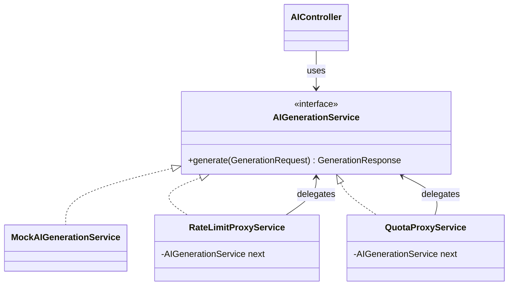

# AI Proxy Platform — Backend

AI consumption platform with **rate limiting** and **monthly token quotas**, built with Spring Boot
to demonstrate the **Proxy design pattern**.

## Proxy pattern mapping

| Role | Class |
|------|-------|
| Subject | `service.AIGenerationService` |
| Real Subject | `service.MockAIGenerationService` (Thread.sleep 1200 ms + random predefined text) |
| Proxy #1 | `proxy.RateLimitProxyService` → **429 Too Many Requests** + `Retry-After` |
| Proxy #2 | `proxy.QuotaProxyService` → **402 Payment Required** |
| Client | `controller.AIController` |
| Chain assembly | `config.ProxyChainConfig` |

```
Client ──► RateLimitProxyService ──► QuotaProxyService ──► MockAIGenerationService
```



## Plans

| Plan | Requests / minute | Tokens / month |
|------|------------------|----------------|
| FREE | 10 | 50,000 |
| PRO | 60 | 500,000 |
| ENTERPRISE | unlimited | unlimited |

Tokens are estimated as `ceil(characters / 4)`; a request consumes prompt + completion tokens.

## Endpoints

Every request must include the header `X-User-Id: <user>` (users are created on demand with the FREE plan).

| Method | Path | Description |
|--------|------|-------------|
| POST | `/api/ai/generate` | Body `{"prompt": "..."}` — goes through the full proxy chain |
| GET | `/api/quota/status` | Tokens used/remaining, reset date, plan, requests this minute, seconds to rate-limit reset |
| GET | `/api/quota/history` | Daily usage for the last 7 days |
| POST | `/api/quota/upgrade` | Body `{"plan": "PRO"}` (default PRO). Only upgrades allowed |
| POST | `/api/ai/estimate` | Body `{"prompt": "..."}` → approximate token count |
| GET | `/actuator/health` | Health check |

## Scheduled tasks (`scheduler.QuotaResetScheduler`)

- Every minute at second 0 → reset per-minute request counters.
- Day 1 of each month at 00:00 → reset monthly token quotas.

## Run locally

```bash
mvn spring-boot:run
# or
mvn package && java -jar target/ai-proxy-platform.jar
```

```bash
curl -X POST localhost:8080/api/ai/generate -H "X-User-Id: andruw" \
     -H "Content-Type: application/json" -d '{"prompt":"What is the Proxy pattern?"}'
curl localhost:8080/api/quota/status -H "X-User-Id: andruw"
```

## Configuration (environment variables)

| Variable | Default | Purpose |
|----------|---------|---------|
| `PORT` | 8080 | HTTP port (Render sets it) |
| `FRONTEND_URL` | localhost:5173 + the Vercel URL | Allowed CORS origins, comma-separated. Wildcards supported |
| `APP_TIMEZONE` | `America/Bogota` | Zone for daily history and resets |
| `AI_MOCK_LATENCY_MS` | 1200 | Simulated AI latency |

## Deploy on Render

1. Render → New → Web Service → `camilin0811/Backend-Proxy`, Language **Docker** (the `Dockerfile` at the repository root is detected automatically).
2. Health Check Path: `/actuator/health`.
3. The Vercel origin is already allowed by default, so no environment variable is required. Set `FRONTEND_URL` only to point the backend at a different frontend.

> Data is stored in memory, so it resets when the service restarts.
